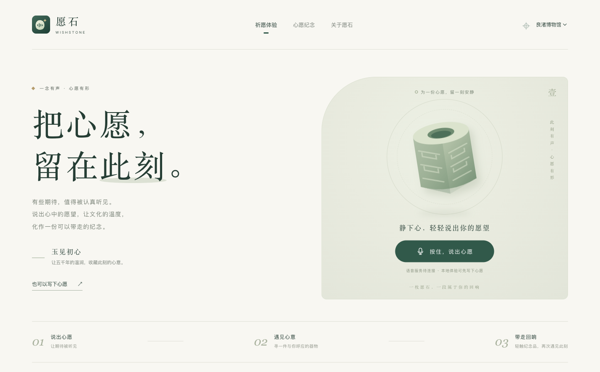
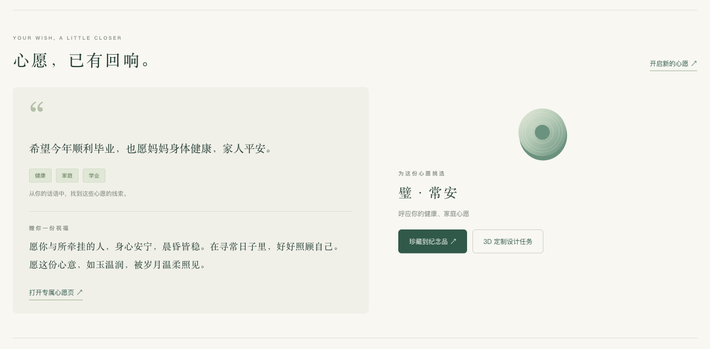
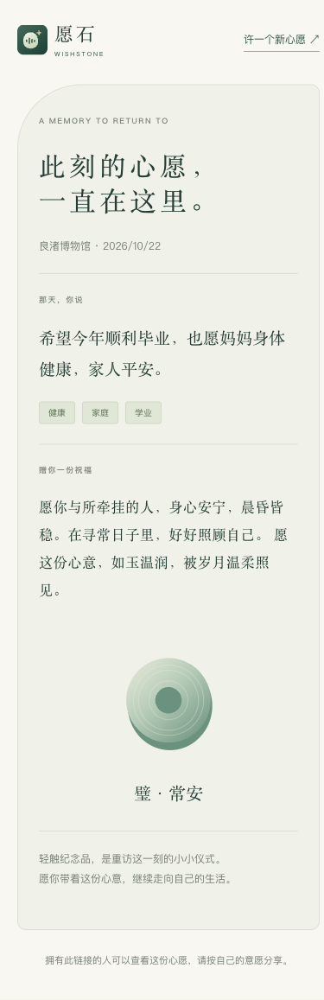

<p align="center">
  
</p>

<h1 align="center">愿石 WishStone · 2.0</h1>

<p align="center">一念有声 · 心愿有形</p>
<p align="center"><a href="LICENSE">个人免费学习 · 禁止商业与盈利使用</a></p>
<p align="center">
  <a href="docs/workflow.md">工作流与接口</a> ·
  <a href="examples/venues/liangzhu.json">良渚示例配置</a> ·
  <a href="docs/raspberry-pi.md">树莓派部署</a>
</p>

**面向文化空间的语音祈愿交互工作流，源码公开供个人免费学习。**

WishStone 将一句心愿转化为一份可被触摸、可再次访问的文化记忆。适用于博物馆、寺庙、古迹等空间，文化语境、祈福类别、回应文案与纪念品由场景配置。仓库提供**良渚博物馆配置示例**，不代表馆方合作或授权。

## 2.0 页面预览

### 说出心愿，让文化的温度成为一份纪念



参考界面采用玉绿色与纸白，支持按住录音、松开结束，也保留文字入口。场景内容通过配置加载。

### 听见心意，找到一件与你呼应的器物



演示输入：**“希望今年顺利毕业，也愿妈妈身体健康，家人平安。”** 分类支持多个心愿，纪念品可按自己的心意更换。

<details>
<summary><strong>查看手机上的专属纪念页</strong></summary>
<br />
<p align="center"></p>

纪念页用于轻触 NFC 后重访心愿。截图来自实际运行的本地页面，使用演示文本。

</details>

图标采用“圆石 × 声纹 × 微光”，提供 [SVG 源文件](app/static/brand/wishstone-icon.svg)、[透明单色标志](app/static/brand/wishstone-mark.svg) 与 [PNG 尺寸包](app/static/brand/)。设计说明见 [品牌资源](docs/brand.md)。

---

## 工作流

```text
按住实体按钮 → 录音 → 松开结束
                       ↓
               SenseVoice 转写
                       ↓
          NLP 识别多个心愿类别
                       ↓
           加载当前场景，匹配纪念品目录
                       ↓
        选择现有款式 ── 可选：生成 3D 设计任务
                       ↓
            保存心愿，生成专属纪念页链接
                       ↓
      将 NDEF URL 写入 NTAG215 → 回读校验
                       ↓
           手机轻触纪念品，重访这份心愿
```

目标参考硬件：**树莓派 4 + 麦克风 + 按钮 + NFC 读写模块 + NTAG215**。当前提供 PN532 I²C 驱动示例；NTAG215 是标签型号，其他读写模块需要替换驱动。

## 先在电脑体验

核心服务仅依赖 **Python 3.10+ 标准库**，无需先安装模型或连接硬件。

```bash
python3 app/server.py
```

打开 [本地体验页](http://127.0.0.1:8080)，展开“也可以写下心愿”，即可体验分类、纪念品匹配、纪念页和 NFC 内容准备。按住页面录音按钮可录音；语音识别需要另行启动下述 ASR 服务。

核心服务默认只监听本机。首次创建 SQLite；升级原版数据库前自动备份到数据目录的 `backups/`。原版录音和记录保留，2.0 不再生成占位转写或提示音冒充 TTS。

## 按场景配置

```bash
cp examples/venues/template.json my-venue.json
VENUE_CONFIG=my-venue.json python3 app/server.py
```

- [良渚示例](examples/venues/liangzhu.json)：玉琮、玉璧、稻穗意象与学业、事业、健康等心愿映射。
- [空白模板](examples/venues/template.json)：改场馆信息、祈福规则、祝福文案和纪念品即可使用。
- 一个文件可配置多个场馆；场馆 ID、装置 ID、纪念品 SKU 用于隔离匹配与绑定。
- 规则分数是命中关键词数量，不是模型概率。并列或无命中会提示用户自行确认纪念品。
- 界面中的器物是原生 SVG 概念图；`motif` 可选 `cong/bi/seed/bell/cloud/lotus/leaf`。新造型可在 `app/static/art.js` 扩展。
- 当前只提供规则 NLP；替换 `app/domain.py` 的 `classify` 即可接入模型，保留相同结构化输出。

完整字段与适配器契约见 [工作流与接口](docs/workflow.md)。

## SenseVoice 与树莓派

提供独立的 **SenseVoice INT8 / sherpa-onnx** HTTP 服务；核心业务无需安装 PyTorch。GPIO 按钮录音也可在无显示器模式运行。安装、模型下载、PN532 接线和 systemd 示例见 [树莓派部署](docs/raspberry-pi.md)。

```bash
# 安装并下载模型后，在两个终端分别运行：
python3 services/sensevoice_server.py
ASR_HTTP_URL=http://127.0.0.1:8091/transcribe python3 app/server.py
```

服务接收 `multipart/form-data` 的 `audio`，返回 `{"text":"识别文本"}`。也可通过 `ASR_HTTP_URL` 换成自己的 ASR 适配器。未配置或识别失败时明确报错，不生成虚构识别结果。

## NFC 与 3D 定制

- 标签写入的是**纪念页链接**，音频、文本和 3D 文件不塞进芯片。
- PN532 驱动检查 NTAG215 默认 CC 所声明的 **496 字节 NDEF 区域**，只写数据页，写后逐字节回读；不修改锁位、密码和配置页。
- 本地 `localhost` 链接仅供预览。写入实物前设置 `PUBLIC_BASE_URL` 为手机可访问的稳定地址，并验证访问路径。
- 桌面浏览器可复制链接给外部写卡工具；兼容设备另提供 Web NFC 路径。主硬件路径仍是树莓派读写器。
- 绑定状态如下。服务端记录设备回执，实物效果仍需验收。

  | 状态 | 含义 |
  | --- | --- |
  | `registered` | 仅登记绑定 |
  | `client_verified` | 浏览器报告回读通过 |
  | `device_verified` | 授权装置报告回读通过 |

- **3D 当前只生成可下载的设计任务**，包含文化意象、尺寸建议和 NFC 腔体参数。没有调用生成模型，没有输出可打印模型；可按任务契约接入服务。打印结构和射频性能需另行验证。

## 模块

```text
app/server.py                   HTTP API、数据库迁移、纪念页与绑定
app/domain.py                   可替换分类器、场景匹配、祝福与设计任务
app/providers.py                可替换 ASR HTTP 客户端
app/static/                     参考装置界面、按住录音、纪念页
examples/venues/                良渚示例与自定义场景模板
services/sensevoice_server.py    可选 SenseVoice ONNX 服务
hardware/pi_station.py          树莓派实体按钮与录音工作流
hardware/ntag215.py              NDEF 编码、PN532 写入和回读
requirements-asr.txt             可选 ASR 依赖
requirements-pi.txt              可选硬件依赖
deploy/                         systemd 参考文件
```

## 验证与边界

```bash
python3 -m unittest discover -s tests -v
node --test tests/recorder.test.mjs
```

测试覆盖 HTTP 主流程、ASR 协议、数据库迁移、标签并发占用、NDEF 编码与录音控制。具体结果见 [本地验证记录](docs/verification.md)。

文字演示已可运行；真实 ASR、GPIO 录音、NFC 读写和 3D 打印仍需实机验收。内容检查目前使用有限规则，公众场景需另行完善审核。

录音默认只用于当次转写，不保存；显式传入 `retain_audio=true` 才保存原始音频。心愿文本和纪念页保存在本地数据库，拥有链接者可访问。`ADMIN_TOKEN` 未设置时管理接口关闭。敏感配置放环境变量，参见 [.env.example](.env.example)。

## 2.0 后续方向

- 用实际场馆语料评估并替换规则分类，保留多心愿和人工确认路径。
- 按服务协议接入 3D 生成、任务轮询与文件审核。
- 增加场馆配置编辑器、硬件状态反馈、异常恢复和设备管理。
- 根据真实空间验证录音体验、推理耗时、纪念品结构与 NFC 感应表现。

## 许可证

本项目采用 [愿石个人学习许可证 1.0](LICENSE)，免费供个人非商业学习、研究和私人实验。

**禁止商业或盈利使用**，包括商业部署、收费体验、付费定制与托管，以及销售相关装置、纪念品或 NFC 产品。其他用途须事先取得单独书面授权。

分享源码及其修改版时须保留许可证、版权与第三方声明。第三方代码、模型、数据和素材遵循各自许可。
