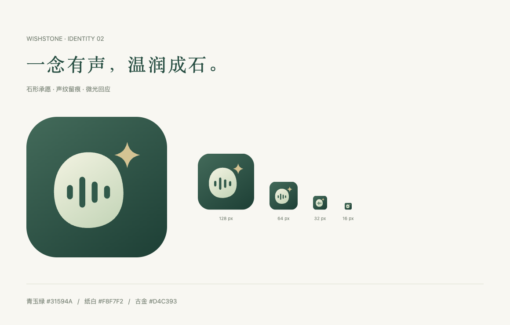

# WishStone 品牌与展示资源

## 图标：圆石、声纹、微光

温润、略带不规则的石形是承载心愿的物件，四段声纹对应表达与聆听，右上方的微光代表被认真回应的期待。图标不绑定某一场馆、神像或器物，良渚的玉石气质是当前示例的视觉起点。

这是直接绘制的原生 SVG，全部几何均可编辑，无字体、外部素材、嵌入位图或 AI 生成图片依赖。

| 文件 | 用途 |
| --- | --- |
| [wishstone-icon.svg](../app/static/brand/wishstone-icon.svg) | 彩色主图标，1024 × 1024 画布 |
| [wishstone-mark.svg](../app/static/brand/wishstone-mark.svg) | 真正镂空、透明背景的单色标志 |
| [1024 PNG](../app/static/brand/wishstone-icon-1024.png) | 高清图标、项目资料 |
| [512 PNG](../app/static/brand/wishstone-icon-512.png) | 常规展示 |
| [192 PNG](../app/static/brand/wishstone-icon-192.png) | 触屏书签图标 |
| [32 PNG](../app/static/brand/wishstone-icon-32.png) | 小尺寸预览 |
| [本地品牌预览页源码](../app/static/brand/preview.html) | 服务启动后访问 `/brand/preview.html` |

核心色为青玉绿 `#31594A`、纸白 `#F8F7F2`，微光采用古金色 `#D4C393`。透明标志内的声纹为镂空，能够随背景变化；小尺寸优先使用彩色方形图标。

参考装置页、纪念页的页头和 favicon 已使用同一图标。关于区的“愿”字印章保留为文化装饰。

## GitHub 页面展示

README 使用本次实际运行页面的截图，均存放在可提交的 `docs/assets/`，不引用被忽略的 `output/` 或开发者绝对路径：

- `kiosk-desktop.png`：装置首页与三个体验步骤。
- `wish-result.png`：文字心愿 → 多类别 → 场景纪念品匹配。
- `memory-mobile.png`：手机纪念页，展示心愿、祝福与纪念品。

演示文本是专门输入的示例，没有上传真实访客录音。截图不证明实际 ASR、GPIO、NFC 或打印硬件工作。

## 重新导出

启动 `python3 app/server.py`，用 Playwright CLI 打开本地首页，再将 `scripts/capture-icons.js`、`scripts/capture-pages.js` 中的函数交给 CLI 的 `run-code` 执行。第二个脚本会创建一条使用公开示例文本的本地会话，以便截取实际结果与纪念页。

截图脚本要求默认良渚配置和 `http://127.0.0.1:8080`。如果使用其他地址或场景，请相应修改脚本。SVG 是图标源文件；PNG 为 Chromium 直接栅格导出。更改主图标后同步更新 `app/static/favicon.svg`。
