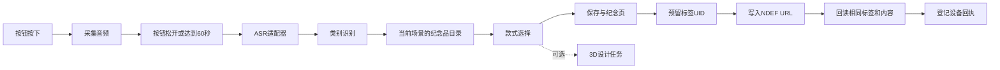

# 2.0 工作流与扩展契约

## 设计边界

核心流程与场馆内容分开。良渚是一个 `examples/venues/liangzhu.json` 示例，通用流程中不硬编码某一博物馆的纪念品。`VENUE_CONFIG` 在启动时加载；编辑后重启服务。



浏览器和树莓派共用会话 API。实体按钮版本默认选择排名第一的纪念品；若有屏幕，可在网页选择后再写入。这里不包含自动出货、库存扣减或打印机控制。

## 场景配置

顶层为 `venues` 数组和 `notice`。每个场馆包含：

| 字段 | 用途 |
| --- | --- |
| `id`, `name`, `type`, `city` | 场馆身份与展示，ID 应稳定且唯一 |
| `device_id` | 示例装置 ID，不能跨场馆提交 |
| `theme`, `description`, `role_name` | 该场景的主题、说明、角色 |
| `motif` | 文化意象，供 3D 任务使用 |
| `intent_rules` | 可选：类别到关键词数组，省略时采用通用规则 |
| `blessings` | 可选：类别到祝福文本；缺失类别使用通用人生祝福 |
| `blessing_suffix` | 可选：场景特有的祝福结尾 |
| `souvenirs` | 当前场景的纪念品目录 |

每个纪念品包含 `sku/name/subtitle/description/intents/motif/material/customizable`，可选 `design_parameters` 覆盖该款式的尺寸、芯片腔体和输出格式建议。`intents` 关联类别。匹配先看主类别，再看其他类别交集；用户可以更换同一场景的款式。开始绑定后款式锁定。

配置目录负责当前可用场景；数据库保留历史场馆与记录，初始化不会覆盖旧场馆名称或 Prompt。新会话保存场景名称快照，旧记录不因换配置而改写。

## HTTP API

| 方法与路径 | 用途 |
| --- | --- |
| `GET /api/health` | 版本与适配器配置状态；配置状态不是健康测试 |
| `GET /api/venues` | 活跃场景、场馆文案、目录 |
| `GET /api/venues/{id}/souvenirs` | 场景纪念品目录 |
| `POST /api/transcriptions` | 单独转写音频 |
| `POST /api/sessions` | 文本或音频 → 分类 → 匹配 → 保存 |
| `GET /api/sessions/{slug}` | 纪念页所需数据 |
| `POST /api/sessions/{slug}/souvenir` | 更换同场馆 SKU |
| `GET /api/sessions/{slug}/nfc` | 准备 NDEF URL，不写芯片 |
| `POST /api/nfc/bind` | 预留 UID / 登记绑定 / 上报写入回执 |
| `POST /api/design-jobs` | 生成或复用设计任务，当前 `brief_ready` |
| `GET /api/admin/stats` | 管理统计 |
| `GET /api/admin/sessions` | 最近会话 |
| `POST /api/admin/sessions/{id}/review` | `pending/approved/blocked` |
| `GET/POST /api/admin/prompts/{venue_id}` | 保留原版 Prompt 配置 API；当前不驱动 LLM |
| `GET /api/admin/nfc-bindings` | 最近绑定与回执 |

管理接口需要 `X-Admin-Token`，环境中未设置则关闭。公众纪念页只读取 `approved` 且安全状态通过的会话；拥有链接即拥有读取能力，勿把页面当作个人隐私保险箱。

### 创建心愿

```json
{"venue_id":"venue-liangzhu","device_id":"device-demo-001","user_text":"希望毕业顺利，也愿家人健康平安"}
```

也支持 `multipart/form-data`：`venue_id/device_id/user_text/audio/retain_audio`。存在非空 `user_text` 时按用户确认后的文本处理，并明确标记 `user-text` 来源；否则音频必须经 ASR。正文最多 1000 字；请求体上限 12 MB；参考客户端录音上限 60 秒。

分类输出中，`intent` 为主类别，`labels` 包含类别、关键词命中数与证据，另有 `emotion/safety/provider/needs_confirmation` 字段。规则命中数不作为概率，情绪字段也仅为规则标签。

### ASR 适配器

`ASR_HTTP_URL` 指向实现下列协议的服务：

- `POST` multipart 字段 `audio` 与 `language=zh`。
- 返回 `{"text":"转写文本"}`；可选 `provider`。不会要求外部厂商特定 SDK。
- 可配置 `ASR_API_TOKEN`，客户端使用 Bearer 头；同一个变量亦可用于自带服务鉴权。
- 空文本、超长文本、超时和错误均返回失败，不构造默认心愿。
- 自带 SenseVoice 服务将音频解码为 16 kHz 单声道，再使用 INT8 ONNX 模型。核心服务不加载模型。

### NFC 回执

先准备链接并读取标签，再提交：

```json
{"blessing_session_id":"实际会话ID","souvenir_sku":"LZ-BI","nfc_uid":"04:A1:B2:C3:D4:E5:F6","method":"manual"}
```

`manual` 为占用/登记，状态 `registered`。相同会话与 UID 幂等；其他会话重复 UID 返回 `409`，并发由 SQLite 写事务保护。

硬件回读成功后以 `method=pn532` 和 `readback_url` 上报，附加 `X-Device-Token`，状态升级为 `device_verified`。浏览器相应为 `method=web-nfc`、`client_verified`。两者都必须匹配服务端准备的链接；它们是设备报告，不是服务端独立检测芯片。

PN532 驱动只接收默认可写的 NTAG215，CC 值为 `E1 10 3E 00`。写入先把 NDEF TLV 标记为空，逐页写数据，最后提交首部并回读比对。失败时保留 `registered`，可对同一心愿重试，不自动覆盖别人的标签。

### 3D 扩展点

当前任务格式：`id/status/provider/prompt/parameters/model_url/notice`。只有 `brief_ready`，`model_url=null`，不声称生成成功。`customizable=false` 的款式不能建立任务。

后续执行器可消费这些任务，另行实现 `queued/running/succeeded/failed` 与 GLB/STL 存储。连接生成服务时应只发送文化意象和类别，不默认上传访客原话或音频。腔体尺寸目前是设计建议，不是制造约束已验证。

## 验证边界与恢复

- V1 数据库首次增加 2.0 字段前使用 SQLite backup API 保存副本；仅追加字段和表，不清空旧数据。
- 原版假 ASR 和 440 Hz 提示音不再作为 AI 能力输出；旧文件保留在磁盘。
- 没有实际硬件时，用假 PN532 测试编码与失败处理；实际录音、推理和射频效果要另做现场验收。
- 标签成功写入而服务器回执暂时失败时，不应重复生成心愿；应针对同一会话重试确认。当前硬件脚本会在进程内保留已生成心愿并重试，重启恢复仍需补充持久任务队列。
